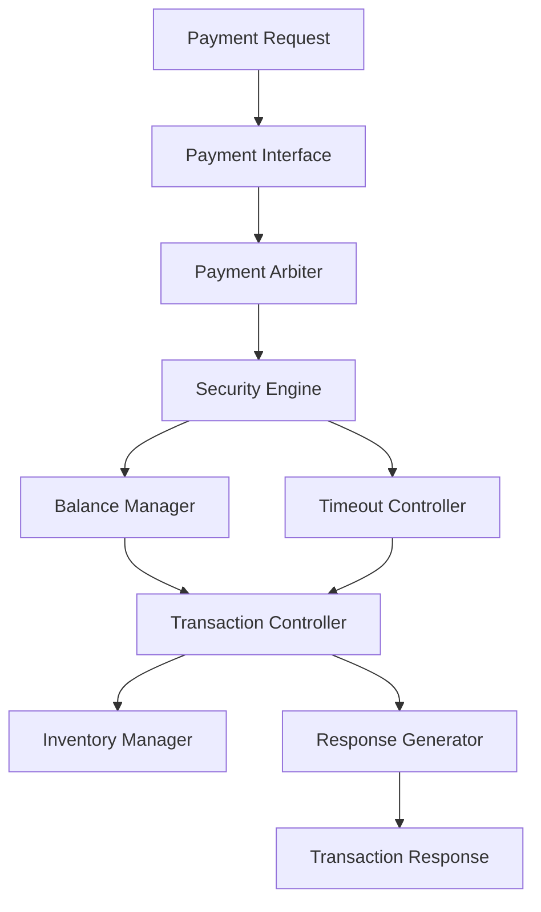
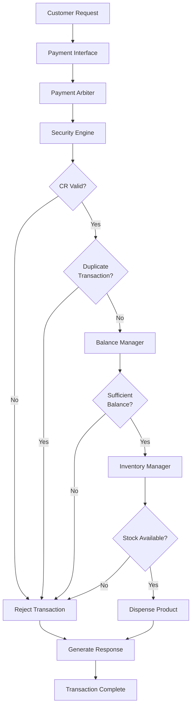

# Secure Vending Machine Controller Architecture

## Overview

The Secure Vending Machine Controller is a modular SystemVerilog design that simulates the operation of a secure automated vending machine supporting multiple payment methods. The controller verifies payment requests, manages customer balance, checks product availability, updates inventory, and generates transaction responses.

The design follows a modular architecture where each functional block performs a dedicated task, making the system scalable, maintainable, and easy to verify.

---

# Top-Level Architecture



---

# Design Modules

## 1. Payment Interface

### Purpose

Receives the transaction request from the user and converts it into an internal packet format used by the controller.

### Responsibilities

- Receive payment request
- Capture transaction ID
- Capture payment type
- Capture product ID
- Capture payment amount
- Generate packet CRC
- Assert packet_valid signal

---

## 2. Payment Arbiter

### Purpose

Accepts validated packets from the Payment Interface and forwards one transaction for processing.

### Responsibilities

- Accept packet
- Forward request
- Prevent multiple simultaneous transactions
- Generate arbitration grant

---

## 3. Security Engine

### Purpose

Performs transaction validation before payment processing.

### Responsibilities

- Verify packet CRC
- Detect duplicate transaction IDs
- Generate security status
- Reject invalid transactions

Possible Errors

- CRC Error
- Duplicate Transaction

---

## 4. Balance Manager

### Purpose

Maintains the customer balance throughout the transaction.

### Responsibilities

- Add deposited amount
- Deduct product price
- Handle refunds
- Clear balance after completion

Operations

```
Add Balance
Subtract Price
Refund Balance
Clear Balance
```

---

## 5. Inventory Manager

### Purpose

Maintains product quantity and pricing information.

### Responsibilities

- Store product prices
- Store product quantities
- Verify stock availability
- Decrement quantity after successful purchase

Memory

```
price_mem[]
qty_mem[]
```

---

## 6. Timeout Controller

### Purpose

Detects incomplete or stalled transactions.

### Responsibilities

- Start timeout timer
- Detect timeout
- Generate timeout signal
- Abort expired transactions

---

## 7. Transaction Controller

### Purpose

Acts as the central control unit coordinating the transaction flow.

### Responsibilities

- Receive validated request
- Check inventory
- Verify balance
- Control dispensing
- Request refund if necessary
- Signal transaction completion

---

## 8. Response Generator

### Purpose

Generates the final transaction response.

### Response Fields

- Transaction Status
- Error Code
- Dispense Signal
- Refund Amount

Possible Status

- STATUS_SUCCESS
- STATUS_FAILED
- STATUS_TIMEOUT
- STATUS_IDLE

Possible Errors

- ERR_NONE
- ERR_BALANCE
- ERR_STOCK
- ERR_DUPLICATE
- ERR_TIMEOUT
- ERR_CRC

---

# Supported Payment Methods

The controller supports six payment methods.

| Payment Method | Description |
|---------------|-------------|
| COIN | Coin-based payment |
| NOTE | Currency note payment |
| RFID | RFID card payment |
| CARD | Debit/Credit card payment |
| UPI | Unified Payments Interface |
| WALLET | Digital wallet payment |

---

# Transaction Flow




---

# Internal Memories

| Memory | Purpose |
|---------|---------|
| price_mem[] | Stores product prices |
| qty_mem[] | Stores available product quantities |

---

# Key Features

- Modular SystemVerilog RTL architecture
- Secure transaction processing
- CRC verification
- Duplicate transaction detection
- Multi-payment support
- Automatic inventory management
- Balance management
- Timeout detection
- Automatic refund handling
- Structured response generation

---

# Design Characteristics

| Parameter | Value |
|-----------|-------|
| RTL Language | SystemVerilog |
| Verification | Directed Self-Checking Testbench |
| Simulator | Vivado XSIM |
| Payment Modes | 6 |
| Inventory Storage | Memory Arrays |
| Transaction Processing | Sequential |
| Error Detection | CRC, Duplicate, Timeout, Stock |

---

# Conclusion

The Secure Vending Machine Controller is implemented using a modular architecture that separates payment handling, security verification, balance management, inventory control, timeout monitoring, and response generation into independent RTL modules. This structure improves readability, simplifies verification, and allows future enhancements such as additional payment methods, interfaces, or advanced verification methodologies without significant architectural changes.