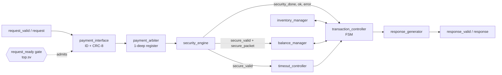
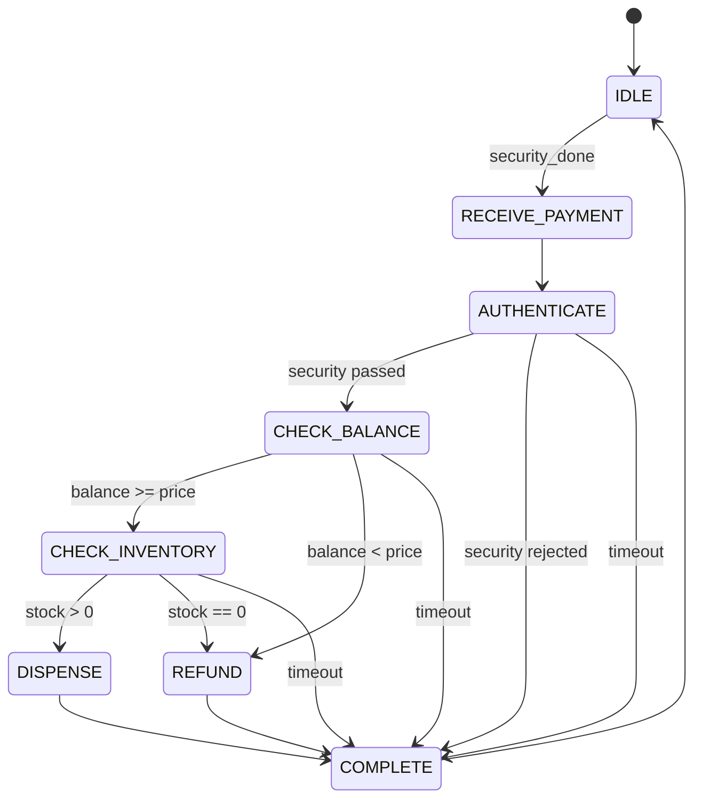

# Architecture

Describes the RTL in `rtl/` as of v1.0.2 (identical to v1.0.1). Interface semantics are in `Protocol Specification.md`; limits are in `known-limitations.md`.

## 1. Block diagram



## 2. Modules

| Module | Responsibility | Notes |
|---|---|---|
| `transaction_pkg` | Types, widths, constants | `PRODUCT_COUNT = 5`; request 24 bits; response 29 bits |
| `crc8` | CRC-8, poly 0x07, init 0, MSB-first, no reflection, no final XOR | 40-bit payload `{payment_type, amount, product_id, transaction_id}` |
| `payment_interface` | Accepts a request when `request_valid && arbiter_ready` (driven by `request_ready` in `top.sv`), assigns a 16-bit transaction ID (starts at 1), registers the packet and a one-clock `packet_valid` | The input is still named `arbiter_ready` for historical reasons |
| `payment_arbiter` | One-deep packet register | With the gate it never holds a packet while a transaction is in progress |
| `security_engine` | Registers one verdict per valid packet. Check order: CRC, duplicate ID (same as previous packet), `product_id >= PRODUCT_COUNT`, `amount == 0`, CARD amount > 5000 | Treats `packet_valid` as a level, not a handshake; this is why the top-level gate is required |
| `balance_manager` | 16-bit balance. Priority: clear, refund, add, subtract | Overflow drops the payment (flag unconnected); unreachable with one outstanding transaction |
| `inventory_manager` | 32-entry price and quantity tables, reset to price (ID+1)x10, quantity 20 | Only IDs 0-4 are reachable |
| `timeout_controller` | Starts on `secure_valid`, expires after 20 clocks, level output cleared by `complete` | Not reachable in normal operation |
| `transaction_controller` | FSM below; drives dispense, refund and complete pulses | `ERROR_STATE` is defined but never entered |
| `response_generator` | Latches dispense/refund, emits the response at `complete` | Response has no transaction ID |
| `top` | Integration; `request_ready` gate; debug outputs | See section 4 |

## 3. FSM (`transaction_controller`)



A `timeout` also overrides the output logic in any state (it forces status/error to TIMEOUT, clears dispense and refund, and asserts `complete`).

## 4. The request gate (`rtl/top.sv`)

```
request_ready = !rst && controller_ready   // FSM in IDLE
                     && !packet_valid      // nothing leaving payment_interface
                     && !out_valid         // nothing held in the arbiter
                     && !security_done;    // no security verdict pending
```

A request is accepted only when the whole pipeline is empty. This is what guarantees one transaction at a time. It replaced v1.0.0, where the interface accepted a request while one was in flight and the level-sensitive security engine then overwrote the in-flight transaction's packet.

## 5. Request timeline (derived from the RTL source)

Clock 0 is the accepting edge. These figures come from reading the RTL (and a cycle-accurate model checked against the maintainer's v1.0.0 results); the regression is expected to confirm them.

| Clock | Success path |
|---|---|
| 1 | `packet_valid` |
| 2 | Packet in arbiter; security engine samples it |
| 3 | `security_done`; balance loaded; timer starts; FSM sees `done` |
| 4-8 | RECEIVE_PAYMENT, AUTHENTICATE, CHECK_BALANCE, CHECK_INVENTORY, DISPENSE |
| 9 | COMPLETE: dispense pulse, price subtracted, quantity decremented |
| 10 | FSM IDLE, `complete` pulse, balance cleared, **`request_ready` high again** |
| 11 | `response_valid` |

`response_valid` appears at clock 8 for a security rejection, 10 for insufficient balance, 11 for success and out-of-stock.

## 6. Behavior that surprises readers

- On success, balance is `amount - price` at clock 10 and then cleared: change is lost (KL-001).
- A new request can be accepted at clock 10, one clock before the previous response is visible.
- Reset restores stock and prices (KL-003).
- `debug_*` outputs and the hierarchical reference in `top.sv` exist for testbenches only; no testbench uses the outputs.
