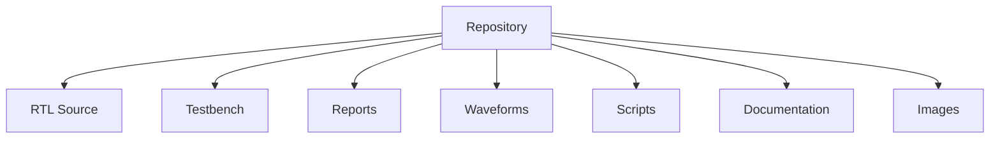

# Directory Structure

## Overview

The project is organized into separate directories for RTL source code, verification environment, simulation reports, waveform captures, automation scripts, and project documentation. This modular structure improves readability, maintainability, and ease of collaboration.

---

# Repository Structure

```text
Secure-Vending-Machine-Verification/
│
├── rtl/
├── tb/
├── reports/
├── waveforms/
├── scripts/
├── docs/
├── images/
├── .gitignore
├── LICENSE
└── README.md
```

---

# rtl/

Contains all SystemVerilog RTL modules implementing the Secure Vending Machine Controller.

```text
rtl/
├── transaction_pkg.sv
├── payment_interface.sv
├── payment_arbiter.sv
├── security_engine.sv
├── timeout_controller.sv
├── balance_manager.sv
├── inventory_manager.sv
├── transaction_controller.sv
├── response_generator.sv
└── top.sv
```

### Description

| File | Purpose |
|------|---------|
| transaction_pkg.sv | Package containing parameters, enums, structs, and typedefs |
| payment_interface.sv | Accepts payment requests and creates transaction packets |
| payment_arbiter.sv | Controls transaction arbitration |
| security_engine.sv | Performs CRC and duplicate transaction checking |
| timeout_controller.sv | Detects transaction timeout |
| balance_manager.sv | Maintains customer balance |
| inventory_manager.sv | Stores product prices and inventory quantities |
| transaction_controller.sv | Controls transaction execution |
| response_generator.sv | Generates transaction response |
| top.sv | Top-level module integrating all RTL blocks |

---

# tb/

Contains the SystemVerilog verification environment.

```text
tb/
├── tb_coin_only.sv
├── tb_card_only.sv
└── tb_mixed_payment.sv
```

### Description

| File | Purpose |
|------|---------|
| tb_coin_only.sv | Verification using coin payments |
| tb_card_only.sv | Verification using card payments |
| tb_mixed_payment.sv | Complete directed self-checking verification environment |

---

# reports/

Contains reports generated automatically after simulation.

```text
reports/
├── multi_payment_report.csv
├── simulation_summary.csv
├── payment_statistics.csv
├── inventory_report.csv
├── Transaction_statistics.csv
├── verification_report.html
└── simulation.log
```

### Description

| Report | Purpose |
|---------|---------|
| multi_payment_report.csv | Transaction-by-transaction results |
| simulation_summary.csv | Overall simulation statistics |
| payment_statistics.csv | Payment method analysis |
| inventory_report.csv | Final inventory state |
| Transaction_statistics.csv | Distribution of detected errors |
| verification_report.html | Browser-viewable verification summary |
| simulation.log | Simulation execution log |

---

# waveforms/

Contains waveform-related files and screenshots.

```text
waveforms/
├── screenshots/
│   ├── 01_reset_operation.png
│   ├── 02_coin_payment.png
│   ├── 03_note_payment.png
│   ├── 04_rfid_payment.png
│   ├── 05_card_payment.png
│   ├── 06_upi_payment.png
│   ├── 07_wallet_payment.png
│   ├── 08_crc_error.png
│   ├── 09_duplicate_transaction.png
│   ├── 10_timeout.png
│   ├── 11_out_of_stock.png
│   ├── 12_inventory_update.png
│   └── 13_back_to_back_transactions.png
└── README.md
```

### Description

Contains representative simulation waveforms demonstrating the functional behavior of the DUT.

---

# scripts/

Contains Tcl scripts for compiling and simulating the project.

```text
scripts/
├── compile.tcl
├── simulate.tcl
├── run_all.tcl
└── README.md
```

### Description

| Script | Purpose |
|---------|---------|
| compile.tcl | Compiles RTL and testbench files |
| simulate.tcl | Elaborates and runs the simulation |
| run_all.tcl | Executes the complete verification flow |

---

# docs/

Contains project documentation.

```text
docs/
├── Architecture.md
├── Verification_Methodology.md
├── Test_Cases.md
├── Results.md
├── Directory_Structure.md
├── Future_Work.md
├── Project_Report.pdf
└── Presentation.pptx
```

### Description

Includes architecture, verification methodology, test documentation, simulation results, and project reports.

---

# images/

Contains figures used throughout the documentation.

```text
images/
├── architecture.png
├── block_diagram.png
├── transaction_flow.png
├── waveform_examples.png
└── github_banner.png
```

---

# Root Files

| File | Purpose |
|------|---------|
| README.md | Main project documentation |
| LICENSE | Open-source license |
| .gitignore | Git ignore rules |

---

# Project Organization



---

# Benefits of the Directory Structure

- Modular organization
- Easy project navigation
- Clear separation of RTL, verification, and documentation
- Simplified report management
- Automation support through Tcl scripts
- Ready for GitHub collaboration and version control

---

# Conclusion

The repository follows a modular directory structure that separates design files, verification environment, simulation artifacts, documentation, and automation scripts. This organization improves maintainability, simplifies collaboration, and allows users to locate project components quickly.