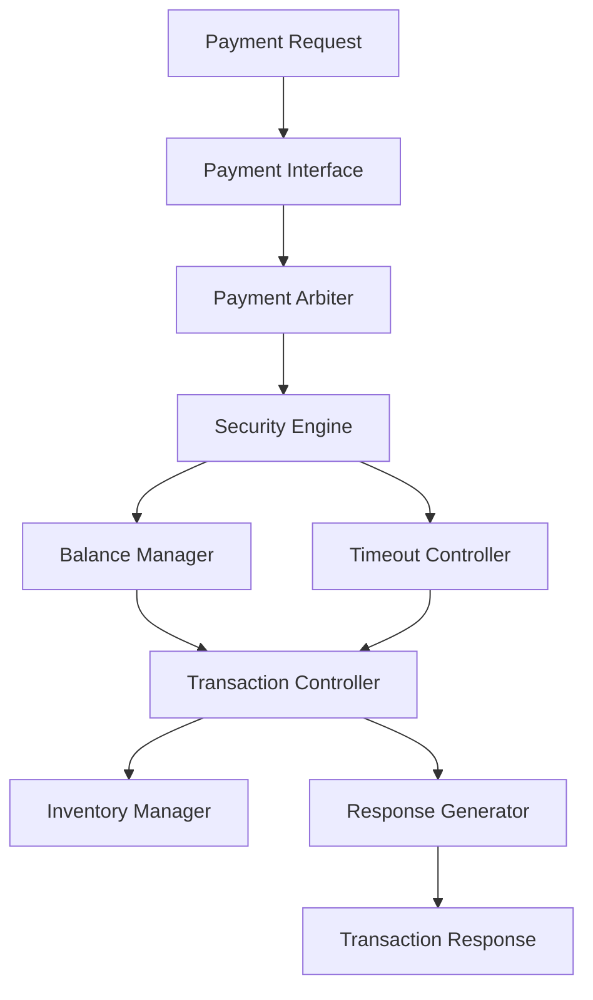

# Project Overview

## Secure Vending Machine Controller
### SystemVerilog RTL Design and Directed Self-Checking Verification

---

## Project Summary

The **Secure Vending Machine Controller** is a modular SystemVerilog-based RTL design that models the operation of a secure automated vending machine supporting multiple payment methods. The controller validates payment requests, authenticates transactions, verifies inventory availability, manages customer balance, and generates transaction responses.

To ensure design correctness, a **directed self-checking verification environment** was developed. The verification environment automatically executes predefined test cases, validates DUT responses, performs internal consistency checks, and generates detailed simulation reports in CSV and HTML formats.

This project demonstrates the complete RTL design and functional verification flow commonly used in digital design and verification.

---

# Project Objectives

- Design a modular Secure Vending Machine Controller using SystemVerilog.
- Support multiple payment methods through a unified transaction interface.
- Validate transactions using CRC and duplicate transaction detection.
- Manage customer balance and inventory during purchases.
- Generate appropriate responses for successful and failed transactions.
- Develop a directed self-checking verification environment.
- Automatically generate simulation reports and verification statistics.

---

# Key Features

## RTL Design

- Modular architecture
- Eight independent RTL modules
- Parameterized design
- Centralized transaction controller
- Secure payment validation
- Inventory management
- Balance management
- Timeout detection

---

## Supported Payment Methods

- Coin
- Note
- RFID
- Card
- UPI
- Digital Wallet

---

## Security Features

- CRC verification
- Duplicate transaction detection
- Timeout monitoring
- Error reporting
- Invalid transaction rejection

---

## Inventory Management

- Product price storage
- Product quantity tracking
- Automatic inventory update
- Out-of-stock detection
- Purchase validation

---

## Verification Features

- Directed verification methodology
- Self-checking testbench
- Automatic PASS/FAIL reporting
- SystemVerilog assertions
- Latency measurement
- Transaction statistics
- Inventory verification
- Balance verification
- CSV report generation
- HTML report generation

---

# RTL Architecture

The Secure Vending Machine Controller consists of the following RTL modules:




Detailed architecture diagrams are available in:

```
docs/Architecture.md
```

---

# Verification Methodology

The controller is verified using a directed self-checking verification environment.

Verification components include:

- Transaction Generator
- Driver
- DUT
- Monitor
- Checker
- Assertions
- Report Generator

Each transaction is automatically checked against the expected result without manual intervention.

---

# Verification Results

| Metric | Result |
|---------|-------:|
| Total Tests | 44 |
| Passed | 44 |
| Failed | 0 |
| Pass Percentage | **100%** |

---

# Test Scenarios

The verification environment validates the following scenarios:

- Reset Verification
- Coin Payment
- Note Payment
- RFID Payment
- Card Payment
- UPI Payment
- Wallet Payment
- Mixed Payment Transactions
- Duplicate Transaction Detection
- CRC Error Detection
- Stock Depletion
- Out-of-Stock Handling
- Back-to-Back Transactions
- Timeout Detection

---

# Generated Reports

The verification environment automatically generates:

```
reports/
│
├── mixed_payment_report.csv
├── simulation_summary.csv
├── payment_statistics.csv
├── inventory_report.csv
├── error_statistics.csv
├── verification_report.html
└── simulation.log
```

---

# Repository Structure

```
Secure-Vending-Machine-Verification/
│
├── rtl/
├── tb/
├── reports/
├── waveforms/
├── images/
├── scripts/
├── docs/
│
├── README.md
├── PROJECT_OVERVIEW.md
├── LICENSE
└── CHANGELOG.md
```

---

# Technologies Used

| Category | Technology |
|----------|------------|
| HDL | SystemVerilog |
| Verification | Directed Self-Checking |
| Simulator | Vivado XSIM |
| Development Environment | Visual Studio Code |
| Version Control | Git |
| Repository | GitHub |
| Reporting | CSV, HTML |
| Documentation | Markdown |

---

# Skills Demonstrated

## RTL Design

- Modular SystemVerilog Design
- Finite State Machine (FSM) Design
- Parameterized Modules
- Package-Based Design
- Memory-Based Inventory Management

---

## Design Verification

- Directed Verification
- Self-Checking Testbench Development
- Assertions
- Functional Debugging
- Latency Measurement
- Transaction Validation
- Report Automation

---

## Software Engineering

- Git Version Control
- GitHub Repository Management
- Documentation
- Automation using Tcl Scripts
- Report Generation

---

# Applications

This controller can serve as the foundation for:

- Smart vending machines
- Automated retail systems
- FPGA-based embedded systems
- Educational RTL and verification projects
- Digital design laboratories

---

# Future Enhancements

Potential future improvements include:

- Universal Verification Methodology (UVM)
- Functional Coverage
- Constrained Random Verification
- FPGA Implementation
- IoT Connectivity
- Mobile Application Interface
- Cloud-Based Inventory Monitoring
- AI-Based Demand Prediction

---

# Project Highlights

- Modular RTL Architecture
- Six Supported Payment Methods
- Directed Self-Checking Verification
- Automatic Report Generation
- Comprehensive Documentation
- Simulation Automation
- 44 Directed Test Cases
- 100% Verification Pass Rate

---

# Conclusion

The Secure Vending Machine Controller demonstrates the complete workflow of RTL design and functional verification using SystemVerilog. The project combines modular hardware design with an automated verification environment capable of validating functionality, checking internal behavior, and generating detailed verification reports.

The project provides practical experience in digital design, RTL development, verification methodologies, simulation, debugging, documentation, and version control, making it suitable as an academic project and a professional portfolio for VLSI Design and Verification roles.