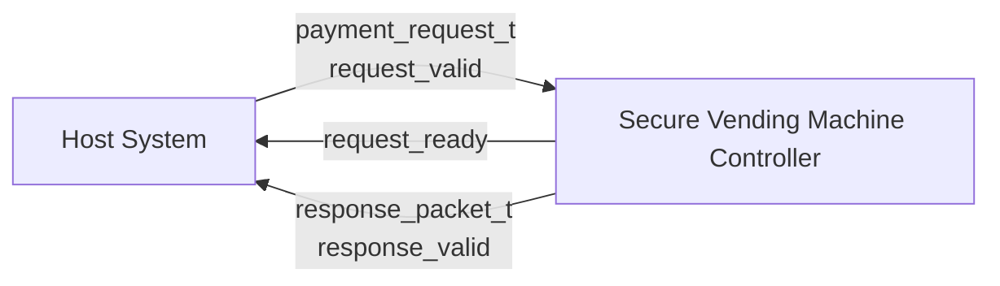

# Protocol Specification

## Secure Vending Machine Controller

Version: 1.0.1 (Post-Audit Hardened)

---

# 1. Introduction

## Purpose

This document specifies the communication protocol used by the Secure Vending Machine Controller (`v1.0.1`). It defines the top-level valid/ready request handshake (Option A), transaction packet format, response packet format, timing requirements, supported payment methods, status codes, and error codes used during transaction processing.

The protocol enables a host system or user interface to communicate with the controller using a standardized, secure transaction format with explicit back-pressure gating.

---

# 2. Interface Overview



---

# 3. Request Interface

## Top-Level Signals

| Signal | Width | Direction | Description |
|---|---:|---|---|
| `clk` | 1 | Input | System clock |
| `rst` | 1 | Input | Active-high synchronous reset |
| `request_valid` | 1 | Input | Indicates a valid payment request is presented |
| `request` | 24 | Input | Structured payment request payload |
| `request_ready` | 1 | Output | Indicates controller is ready to accept a new request |
| `response` | 32 | Output | Structured transaction response packet |
| `response_valid` | 1 | Output | Single-cycle pulse indicating response availability |

---

# 4. Valid/Ready Handshake Contract (Option A)

The Secure Vending Machine Controller enforces a strict **Option A Valid/Ready Handshake Contract**:

1. **Acceptance Event:**
   A request is accepted if and only if **both `request_valid` and `request_ready` are asserted (`1'b1`) on the rising edge of `clk` (`posedge clk`)**.
2. **Requester Obligations:**
   - The requester asserts `request_valid` and drives the payload `request` (typically on `negedge clk` half a period prior to the clock edge).
   - If `request_ready == 0`, the requester **must maintain `request_valid == 1` and keep all request fields (`payment_type`, `amount`, `product_id`) completely stable**.
   - The requester shall deassert `request_valid` only after observing the accepting clock edge where `request_valid && request_ready == 1`.
3. **Controller Readiness Gate:**
   To protect the downstream pipeline (`payment_arbiter`, `security_engine`, `transaction_controller`, resource managers) against concurrent packet corruption or level-sensitive race conditions, `request_ready` is gated as:
   ```systemverilog
   assign request_ready = !rst
                        && controller_ready   // FSM in IDLE
                        && !packet_valid     // payment_interface empty
                        && !out_valid        // arbiter empty
                        && !security_done;   // security_engine idle
   ```
4. **Reset Behavior:**
   During synchronous reset (`rst == 1`), `request_ready` is driven to `0`. No transactions are admitted into the pipeline during reset.

---

# 5. Payment Request Format

```systemverilog
typedef struct packed
{
    payment_t                    payment_type;
    logic [BALANCE_WIDTH-1:0]    amount;
    logic [PRODUCT_ID_WIDTH-1:0] product_id;
} payment_request_t;
```

## Fields

| Field | Width | Description |
|---|---:|---|
| `payment_type` | 3 bits | Payment method enum (COIN, NOTE, RFID, CARD, UPI, WALLET) |
| `amount` | 16 bits | Payment amount tendered |
| `product_id` | 5 bits | Selected product index (0 to `PRODUCT_COUNT-1`) |

---

# 6. Supported Payment Types

| Enum Value | Identifier | Payment Method | Specific Constraints |
|---:|---|---|---|
| `3'd0` | `COIN` | Coin Validator | Standard physical currency |
| `3'd1` | `NOTE` | Bill Acceptor | Standard paper currency |
| `3'd2` | `RFID` | Contactless RFID Card | Tap-to-pay |
| `3'd3` | `CARD` | Credit/Debit Card | Max auth limit: 5000 (amounts > 5000 reject with `ERR_AUTH`) |
| `3'd4` | `UPI` | Unified Payments Interface | QR / Digital mobile payment |
| `3'd5` | `WALLET` | Digital Wallet | Pre-loaded stored-value account |

---

# 7. Internal Transaction Packet

The `payment_interface` converts accepted requests into internal transaction packets with hardware-generated 16-bit monotonic transaction counters and 8-bit CRC protection:

```systemverilog
typedef struct packed
{
    payment_t                     payment_type;
    logic [BALANCE_WIDTH-1:0]     amount;
    logic [PRODUCT_ID_WIDTH-1:0]  product_id;
    logic [TRANSACTION_WIDTH-1:0] transaction_id;
    logic [7:0]                   crc;
} transaction_packet_t;
```

---

# 8. Response Packet

```systemverilog
typedef struct packed
{
    status_t                  status;
    error_t                   error;
    logic [BALANCE_WIDTH-1:0] refund;
    logic                     dispense;
} response_packet_t;
```

## Response Fields

| Field | Description |
|---|---|
| `status` | Overall transaction outcome (`STATUS_SUCCESS`, `STATUS_FAILED`, `STATUS_TIMEOUT`) |
| `error` | Diagnostic error code (`ERR_NONE`, `ERR_BALANCE`, `ERR_STOCK`, `ERR_AUTH`, etc.) |
| `refund` | Refund amount returned to customer |
| `dispense` | Dispense actuator trigger (`1` = product dispensed, `0` = no dispense) |

---

# 9. Status and Error Encodings

### Status Codes (`status_t`)
- `STATUS_IDLE` (`4'd0`): Controller is idle.
- `STATUS_BUSY` (`4'd1`): Transaction in progress.
- `STATUS_SUCCESS` (`4'd2`): Product dispensed successfully; balance cleared.
- `STATUS_FAILED` (`4'd3`): Transaction rejected or resource check failed.
- `STATUS_TIMEOUT` (`4'd4`): Transaction timed out; customer refunded if balance was loaded.
- `STATUS_CANCELLED` (`4'd5`): Transaction aborted.

### Error Codes (`error_t`)
- `ERR_NONE` (`8'd0`): Clean transaction; no error.
- `ERR_TIMEOUT` (`8'd1`): Transaction timeout timer expired.
- `ERR_INVALID_PRODUCT` (`8'd2`): Requested `product_id >= PRODUCT_COUNT`.
- `ERR_CRC` (`8'd3`): CRC checksum failure detected by `security_engine`.
- `ERR_AUTH` (`8'd4`): Payment authentication failed (e.g. CARD amount > 5000).
- `ERR_BALANCE` (`8'd5`): Zero payment amount tendered or insufficient balance for product price.
- `ERR_STOCK` (`8'd6`): Product quantity is zero (out of stock).
- `ERR_DUPLICATE` (`8'd7`): Duplicate `transaction_id` replayed.

---

# 10. Protocol Invariants & Rules

1. **Atomicity:** Only one transaction is in-flight at any time across the pipeline.
2. **Stable Pending State:** Requesters must hold `request_valid` and payload steady while `request_ready == 0`.
3. **Clean Deassertion:** Requesters must deassert `request_valid` immediately following the accepting clock edge to prevent unintended duplicate transaction initiation.
4. **Clean Exit:** On every transaction completion (`STATUS_SUCCESS`, `STATUS_FAILED`, or `STATUS_TIMEOUT`), internal balance is cleared to `0`.
5. **Inventory Decrement:** Inventory quantity is decremented by exactly 1 if and only if `dispense == 1'b1`. In failed transactions, inventory is untouched.
