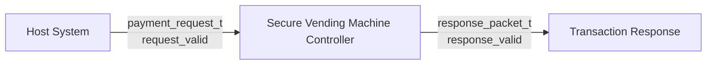
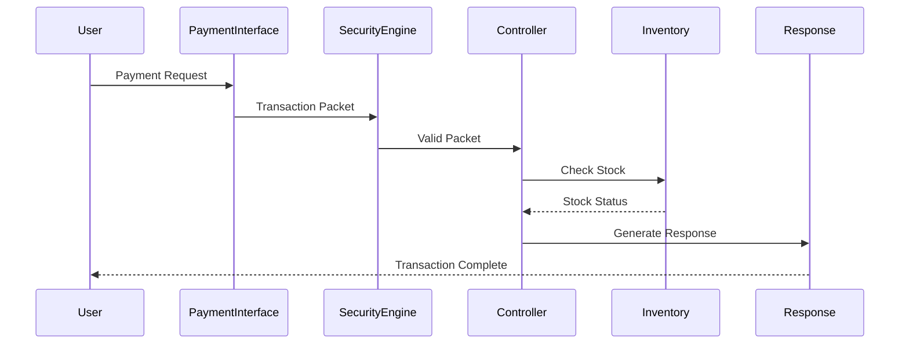
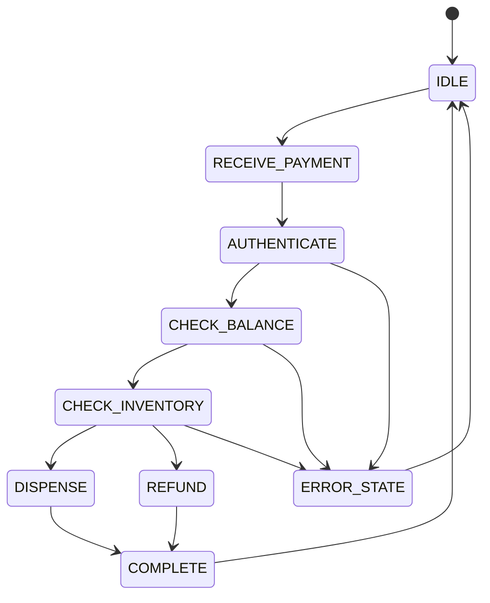

# Protocol Specification

## Secure Vending Machine Controller

Version: 1.0

---

# 1. Introduction

## Purpose

This document specifies the communication protocol used by the Secure Vending Machine Controller. It defines the request interface, transaction packet format, response packet format, timing requirements, supported payment methods, status codes, and error codes used during transaction processing.

The protocol enables a host system or user interface to communicate with the controller using a standardized transaction format.

---

# 2. Interface Overview


---

# 3. Request Interface

## Input Signals

| Signal | Width | Direction | Description |
|---------|------:|-----------|-------------|
| clk | 1 | Input | System clock |
| rst | 1 | Input | Active-high synchronous reset |
| request_valid | 1 | Input | Indicates a valid request |
| request | Structured | Input | Payment request |

---

# 4. Payment Request Format

```systemverilog
typedef struct packed
{
    payment_t payment_type;
    logic [15:0] amount;
    logic [4:0] product_id;
} payment_request_t;
```

---

## Fields

| Field | Width | Description |
|--------|------:|-------------|
| payment_type | 3 bits | Payment method |
| amount | 16 bits | Payment amount |
| product_id | 5 bits | Selected product |

---

# 5. Supported Payment Types

| Value | Payment |
|-------:|---------|
| 0 | Coin |
| 1 | Note |
| 2 | RFID |
| 3 | Card |
| 4 | UPI |
| 5 | Wallet |

---

# 6. Internal Transaction Packet

The Payment Interface converts the request into an internal transaction packet.

```systemverilog
typedef struct packed
{
    payment_t payment_type;
    logic [15:0] amount;
    logic [4:0] product_id;
    logic [15:0] transaction_id;
    logic [7:0] crc;
} transaction_packet_t;
```

---

## Transaction Packet Fields

| Field | Width |
|--------|------:|
| Payment Type | 3 |
| Amount | 16 |
| Product ID | 5 |
| Transaction ID | 16 |
| CRC | 8 |

---

# 7. Response Packet

```systemverilog
typedef struct packed
{
    status_t status;
    error_t error;
    logic [15:0] refund;
    logic dispense;
} response_packet_t;
```

---

## Response Fields

| Field | Description |
|--------|-------------|
| status | Transaction status |
| error | Error code |
| refund | Refund amount |
| dispense | Dispense control |

---

# 8. Transaction Status Codes

| Status | Description |
|---------|-------------|
| STATUS_IDLE | Controller idle |
| STATUS_BUSY | Transaction in progress |
| STATUS_SUCCESS | Transaction completed successfully |
| STATUS_FAILED | Transaction failed |
| STATUS_TIMEOUT | Transaction timed out |
| STATUS_CANCELLED | Transaction cancelled |

---

# 9. Error Codes

| Error | Description |
|--------|-------------|
| ERR_NONE | No error |
| ERR_TIMEOUT | Transaction timeout |
| ERR_INVALID_PRODUCT | Invalid product ID |
| ERR_CRC | CRC mismatch |
| ERR_AUTH | Authentication failure |
| ERR_BALANCE | Insufficient balance |
| ERR_STOCK | Product unavailable |
| ERR_DUPLICATE | Duplicate transaction |

---

# 10. Transaction Sequence



---

# 11. Controller State Machine




---

# 12. Protocol Rules

## Request Rules

- `request_valid` shall be asserted for one clock cycle.
- Request fields shall remain stable while `request_valid` is asserted.
- Only one request shall be active at a time.

---

## Response Rules

- `response_valid` is asserted when the transaction completes.
- Response fields remain valid while `response_valid` is high.

---

## Security Rules

Every transaction shall include:

- Transaction ID
- CRC

The Security Engine verifies:

- CRC correctness
- Duplicate transaction IDs

---

## Inventory Rules

Successful purchase:

- Quantity decreases by one.

Failed purchase:

- Inventory remains unchanged.

---

## Balance Rules

Successful purchase:

```
Balance = Balance − Product Price
```

Failed purchase:

```
Refund = Current Balance
```

Transaction complete:

```
Balance = 0
```

---

# 13. Timeout Behaviour

If the controller does not complete a transaction within the timeout period:

Status:

```
STATUS_TIMEOUT
```

Error:

```
ERR_TIMEOUT
```

---

# 14. Protocol Compliance

A transaction is considered protocol-compliant if:

- Valid request format
- Valid CRC
- Unique transaction ID
- Valid product ID
- Sufficient balance
- Product available
- Transaction completes before timeout

---

# 15. Verification Support

The protocol is verified using:

- Directed Testbench
- Self-checking Scoreboard
- Assertions
- CSV Reports
- HTML Reports
- Simulation Logs

---

# 16. Summary

| Item | Value |
|------|-------|
| Request Interface | payment_request_t |
| Response Interface | response_packet_t |
| Payment Methods | 6 |
| Status Codes | 6 |
| Error Codes | 8 |
| Transaction ID | 16 bits |
| CRC | 8 bits |
| Verification | Directed Self-Checking |
| Simulator | Vivado XSIM |

---

# Conclusion

This protocol specification defines the communication interface between the host system and the Secure Vending Machine Controller. It standardizes transaction requests, response packets, timing behavior, security checks, and controller operation, providing a consistent interface for design, verification, and future system integration.