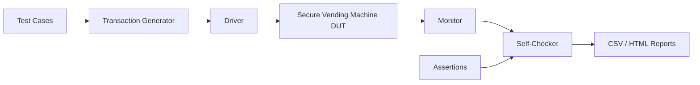
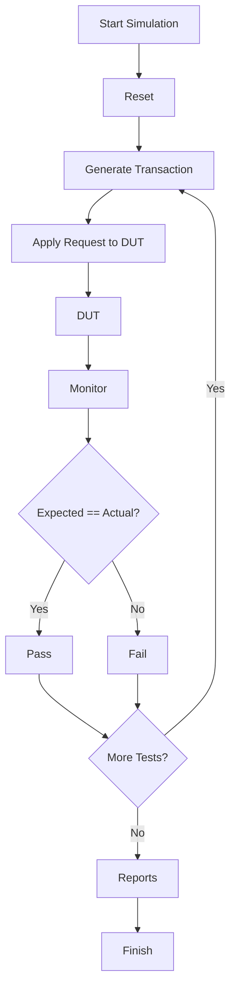

# Verification Methodology

## Overview

The Secure Vending Machine Controller was verified using a **SystemVerilog directed self-checking verification environment**. The verification strategy focuses on validating all functional requirements of the controller by executing predefined test scenarios and automatically comparing the expected and actual outputs.

The testbench generates transaction requests, monitors DUT responses, performs automatic result checking, collects verification statistics, and generates multiple verification reports.

---

# Verification Environment

---

# Verification Components

## Transaction Generator

Generates transaction packets for different payment methods.

Supported payment methods:

- COIN
- NOTE
- RFID
- CARD
- UPI
- WALLET

Each transaction includes:

- Transaction ID
- Payment Type
- Product ID
- Payment Amount
- CRC

---

## Driver

The driver applies generated transactions to the DUT through the request interface.

Responsibilities:

- Drive transaction request
- Apply valid signal
- Wait for DUT acceptance
- Synchronize with system clock

---

## Device Under Test (DUT)

The DUT consists of the following RTL modules:

- Payment Interface
- Payment Arbiter
- Security Engine
- Balance Manager
- Inventory Manager
- Timeout Controller
- Transaction Controller
- Response Generator

---

## Monitor

The monitor observes DUT outputs without modifying DUT behavior.

Captured signals include:

- Transaction Status
- Error Code
- Dispense Signal
- Refund Amount
- Inventory Update

---

## Self-Checking Mechanism

The verification environment automatically compares the DUT response against the expected result.

Checks performed:

- Correct transaction status
- Correct error code
- Correct dispense signal
- Correct refund amount
- Correct inventory update
- Correct balance update

Each test is reported as:

- PASS
- FAIL

---

## Assertions

SystemVerilog assertions are used to validate critical DUT behavior during simulation.

Assertions include:

- Inventory decrement after successful dispense
- Balance cleared after transaction completion
- No unknown values on response outputs
- Legal transaction completion

---

# Verification Flow

---

# Test Categories

The verification suite includes the following directed tests.

| Test Category | Purpose |
|--------------|---------|
| Reset | Verify DUT initialization |
| Coin Payment | Validate coin transaction |
| Note Payment | Validate note transaction |
| RFID Payment | Validate RFID transaction |
| Card Payment | Validate card transaction |
| UPI Payment | Validate UPI transaction |
| Wallet Payment | Validate wallet transaction |
| Mixed Transactions | Verify multiple payment modes |
| Duplicate Transaction | Verify duplicate ID detection |
| CRC Error | Verify CRC checking |
| Timeout | Verify timeout handling |
| Stock Depletion | Verify inventory decrement |
| Out of Stock | Verify stock error |
| Back-to-Back Transactions | Verify consecutive requests |

---

# Verification Reports

The verification environment automatically generates:

- mixed_payment_report.csv
- simulation_summary.csv
- payment_statistics.csv
- inventory_report.csv
- error_statistics.csv
- verification_report.html
- simulation.log

These reports provide transaction logs, simulation statistics, inventory status, payment analysis, latency information, and error distribution.

---

# Verification Features

- Directed verification methodology
- Self-checking testbench
- Automatic pass/fail reporting
- SystemVerilog assertions
- CSV report generation
- HTML report generation
- Simulation logging
- Latency measurement
- Inventory verification
- Payment statistics
- Error statistics

---

# Verification Summary

| Item | Description |
|------|-------------|
| Verification Language | SystemVerilog |
| Verification Style | Directed Self-Checking |
| Simulator | Vivado XSIM |
| Assertions | Yes |
| Functional Coverage | No |
| CSV Reports | Yes |
| HTML Report | Yes |
| Simulation Log | Yes |
| Test Cases | 44 |
| Pass Rate | 100% |

---

# Conclusion

The Secure Vending Machine Controller was verified using a directed self-checking verification methodology. The environment automatically applies transaction scenarios, validates DUT responses, checks internal functionality using assertions, and generates comprehensive verification reports. This methodology ensures that all implemented features—including payment processing, security checks, balance management, inventory updates, timeout handling, and response generation—are verified in a repeatable and automated manner.