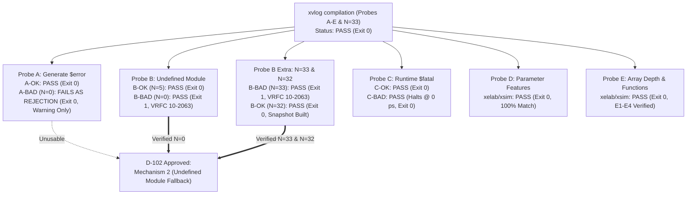

# Phase 0/1 Compatibility Evidence Summary (Reconciled)

**Project:** Secure Vending Machine Controller (v1.0.3 Patch Release)  
**Deliverable:** Reconciled Phase 0 & Phase 1 Execution Summary & Decision Gate  
**Date:** 2026-11-18  
**Execution Host:** Windows 11 Pro 64-bit  
**Toolchain:** Vivado Design Suite 2018.2 (SW Build 2258646, 64-bit)  
**Detailed Reconciled Reports:**
* Environment Audit: [VIVADO_2018_2_ENVIRONMENT_REPORT.md](file:///C:/Users/User/Documents/Projects/v1.0.3-phase0-1/reports/final/VIVADO_2018_2_ENVIRONMENT_REPORT.md)
* Probe Results: [VIVADO_PROBE_RESULTS.md](file:///C:/Users/User/Documents/Projects/v1.0.3-phase0-1/reports/final/VIVADO_PROBE_RESULTS.md)
* D-102 Recommendation: [D102_DECISION_RECOMMENDATION.md](file:///C:/Users/User/Documents/Projects/v1.0.3-phase0-1/reports/final/D102_DECISION_RECOMMENDATION.md)
* Decision Register: [DECISION_REGISTER.md](file:///C:/Users/User/Documents/Projects/v1.0.3-phase0-1/reports/final/DECISION_REGISTER.md)
* Implementation Plan: [V1.0.3_IMPLEMENTATION_PLAN.md](file:///C:/Users/User/Documents/Projects/v1.0.3-phase0-1/reports/final/V1.0.3_IMPLEMENTATION_PLAN.md)
* Probe Documentation: [PROBE_README.md](file:///C:/Users/User/Documents/Projects/v1.0.3-phase0-1/reports/final/PROBE_README.md)
* N=33 Execution Log: [N33_PROBE_RESULT.log](file:///C:/Users/User/Documents/Projects/v1.0.3-phase0-1/reports/final/N33_PROBE_RESULT.log)

---

## 1. Executive Summary

This executive summary reconciles the Phase 0 baseline audit and Phase 1 implementation planning with complete empirical evidence gathered from the Xilinx Vivado 2018.2 toolchain. 

All technical questions surrounding parameter rejection (**D-102**), language capabilities, and boundary conditions have been experimentally resolved:
1. **D-102 Mechanism 2 (Undefined Module Fallback)** is proven to reliably halt static elaboration with exit code `1` and error code `VRFC 10-2063` for both lower out-of-range (`N=0`) and upper out-of-range (`N=33`) parameters.
2. Valid configurations (`N=5` default and `N=32` boundary) elaborate cleanly with exit code `0`.
3. All proposed SystemVerilog language features (package constants, `2**W`, array querying via `$size` and `$bits`, `$isunknown`, and package constant functions in bounds) operate with 100% fidelity.
4. The project maintainer has formally approved the decision register (D-101 through D-114). With the N=33 condition now empirically verified, Phase 0 and Phase 1 objectives are completely satisfied.

---

## 2. Environment Verification Status

| Item | Status | Verified Details |
|---|---|---|
| **Vivado Version** | **VERIFIED** | `Vivado v2018.2 (64-bit)`, SW Build `2258646`, IP Build `2256618` |
| **Compiler (`xvlog`)** | **VERIFIED** | SystemVerilog 2012 support confirmed, version `2018.2`, exit code `0` |
| **Elaborator (`xelab`)** | **VERIFIED** | Multi-threaded static elaboration confirmed (10 threads), exit code `0` |
| **Simulator (`xsim`)** | **VERIFIED** | Interactive & batch execution confirmed with `--runall`, exit code `0` |
| **Tcl Shell Interface** | **VERIFIED** | Batch and interactive `exec` wrappers operational; stderr redirection confirmed |
| **Synthesis Front-End** | **UNVERIFIED** | Not run during Phase 0/1; simulation-only release scope |

---

## 3. Comprehensive Probe Results Summary

| Probe | Condition Tested | Stage | Exit Code | Diagnostic Message / Output | Final Finding |
|---|---|---|---|---|---|
| **Compile All** | Probes A, B, C, D, E | `xvlog` | `0` | Clean analysis into `work` | All SV syntax valid |
| **A-OK** | Generate `$error` (N=5) | `xelab` | `0` | Snapshot `pa_ok` created | Valid config elaborates |
| **A-BAD** | Generate `$error` (N=0) | `xelab` | `0` | `WARNING: [#UNDEF] PROBE_A: N=0 is outside 1..32` | **REJECTED** (Cannot block invalid config) |
| **B-OK** | Undefined module (N=5) | `xelab` | `0` | Snapshot `pb_ok` created | Valid config elaborates |
| **B-BAD (N=0)** | Undefined module (N=0) | `xelab` | `1` | `ERROR: [VRFC 10-2063] Module <PRODUCT_COUNT_OUT_OF_RANGE_see_docs> not found` | **PASSED** (Rejects lower boundary) |
| **Compile N=33**| Probe B N=33 & N=32 | `xvlog` | `0` | Clean analysis into `work` | Isolated test syntax valid |
| **B-BAD (33)** | Undefined module (N=33)| `xelab` | `1` | `ERROR: [VRFC 10-2063] Module <PRODUCT_COUNT_OUT_OF_RANGE_see_docs> not found` | **PASSED** (Rejects upper boundary) |
| **B-OK (32)** | Undefined module (N=32)| `xelab` | `0` | Snapshot `pb_ok_32` created | **PASSED** (Boundary 32 accepted) |
| **C-OK** | Runtime `$fatal` (N=5) | `xsim` | `0` | `PROBE_C_OK` at 10 ns | Valid config simulates |
| **C-BAD** | Runtime `$fatal` (N=0) | `xsim` | `0` | `Fatal: PROBE_C: N=0 is outside 1..32` at 0 ps | Functional runtime safeguard |
| **D** | SV parameters & read | `xsim` | `0` | `PROBE_D dut: PC=8 MAX=32 rd(out-of-range)=0` | 100% verified |
| **E** | Array queries & functions| `xsim` | `0` | `size=8, bits=64, oob=1, last=20, DEPTH=8, safe_count=1 32 5`| 100% verified |

---

## 4. Reconciled Decision Register Status (D-101 .. D-114)

Maintainer approval was granted for the proposed decisions in this conversation. With N=33 verified, D-102 condition is met:

| ID | Topic | Technical Evidence Status | Maintainer Approval Status | Final Status |
|---|---|---|---|---|
| **D-101** | Rename package count constant | Verified by baseline audit | Approved | **Ready** |
| **D-102** | Reject invalid counts (0, 33) | **Verified (Probes A, B, B-N33)** | **Approved (Condition Met)** | **Ready** |
| **D-103** | Inventory table depth & clamp | Language features verified (Probe E); RTL depth pending Phase 2 | Approved | **Ready** |
| **D-104** | Internal ready naming | Verified by reference search | Approved | **Ready** |
| **D-105** | `temp_sum` refactor | Preserved as deferred | Approved (Deferral confirmed) | **Deferred** |
| **D-106** | Merge-only manifest update | Verified by script audit | Approved | **Ready** |
| **D-107** | Count 32 support | Verified by Probes B, D | Approved | **Ready** |
| **D-108** | Invalid inventory ID behavior | Language features verified (Probes D/E); RTL unit test pending Phase 2 | Approved | **Ready** |
| **D-109** | Remove `debug_state` | Verified by reference search | Approved | **Ready** |
| **D-110** | Remove unused security registers | Verified by code scan | Approved | **Ready** |
| **D-111** | Negative runner & manifest fixes | Verified by Probe B / Tcl | Approved | **Ready** |
| **D-112** | Historical doc banners | Verified by doc audit | Approved | **Ready** |
| **D-113** | Baseline commit `6f7ab63` | Verified from v1.0.2 archive | Approved | **Ready** |
| **D-114** | `CITATION.cff` update timing | Preserved as deferred | Approved (Deferral confirmed) | **Deferred** |

---

## 5. Architectural Alignment & Verification Boundaries

1. **RTL Path:** Validated parameter check architecture applies strictly to `rtl/top.sv` (not `svm_top.sv`).
2. **Validation Ownership:** `rtl/top.sv` authoritatively checks public `PRODUCT_COUNT` and passes it to submodules. `inventory_manager` does not add a competing validation block; submodules maintain `PC_SAFE` structural clamps.
3. **D-103 Evidence Boundary:** Probe E verified the relevant SystemVerilog language features (package constant functions, `$size`, `$bits`, out-of-range reads on unpacked arrays, hierarchical localparam access). Actual `inventory_manager` array depth and parameter propagation have **not** been verified in RTL and are marked as Phase 2 verification requirements.
4. **D-108 Evidence Boundary:** Probes D and E demonstrated isolated guarded-index and out-of-range read behavior in standalone probe modules. Actual `inventory_manager` invalid-access handling has **not** yet been tested in RTL; direct unit tests in `tb_inventory_manager.sv` (including per-entry memory snapshots before and after invalid operations) are marked as Phase 2 verification requirements.
5. **Synthesis Status:** Labeled strictly as unverified by experimental evidence.

---

## 6. Remaining Blockers Before Phase 2 Implementation

1. **Phase 2 Authorization:** Awaiting explicit maintainer authorization to open Phase 2.
2. **Maintenance Branch Creation:** Create branch `maintenance/v1.0.3` starting at tag `v1.0.2` (`6f7ab63bd007580f287de0fb42985b9cfbd770c0`).

---

## 7. Recommended Next Action

Submit this reconciled final evidence package to the maintainer for final review and authorization to proceed with Phase 2 implementation.
